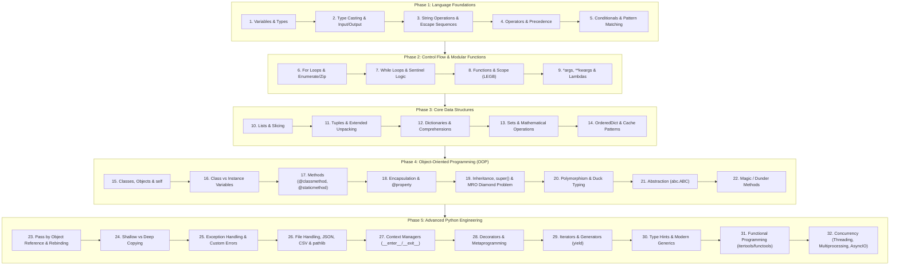

# 🐍 Python Mastery: Basics to Advanced

[](https://www.python.org/)
[](https://peps.python.org/pep-0008/)
[]()
[](https://github.com/bishalkumarnag)
[](https://www.linkedin.com/in/bishalkumarnag/)

A comprehensive, production-grade reference repository covering **Python Fundamentals** through **Advanced Engineering Concepts**. Every single module is self-contained and executable, featuring:
1. 📖 **Short Theory & Core Concepts** — Concise explanations, memory rules, and architectural rationale.
2. 📝 **Syntax Reference** — Signatures, cheat sheets, and best practice patterns.
3. 💡 **Solved Examples** — Runnable, step-by-step code with expected outputs documented.
4. ⚠️ **Common Pitfalls & Gotchas** — Memory leaks, shadowing, mutable default traps, and time complexities.

---

## 🗺️ Recommended Learning & Practice Sequence

For the best learning experience, follow this step-by-step roadmap:

```
[Phase 1: Foundations] ➔ [Phase 2: Flow & Functions] ➔ [Phase 3: Data Structures]
                                                               ⬇
                           [Phase 5: Advanced Engineering] ⬅ [Phase 4: OOP Mastery]
```



---

## 📑 Detailed Table of Contents

- [📚 Core Fundamentals (`Basics/`)](#-core-fundamentals-basics)
  - [1. Variables & Data Types](#1-variables--data-types)
  - [2. Operators & Escape Sequences](#2-operators--escape-sequences)
  - [3. Conditionals & Pattern Matching](#3-conditionals--pattern-matching)
  - [4. Loops & Iteration](#4-loops--iteration)
  - [5. Functions & Scopes](#5-functions--scopes)
  - [6. Data Structures](#6-data-structures)
  - [7. Solved Practice Sets](#7-solved-practice-sets)
- [🚀 Advanced Python Engineering (`Advanced/`)](#-advanced-python-engineering-advanced)
  - [1. Object-Oriented Programming (OOP)](#1-object-oriented-programming-oop)
  - [2. Decorators & Metaprogramming](#2-decorators--metaprogramming)
  - [3. Generators & Iterators](#3-generators--iterators)
  - [4. Exception Handling](#4-exception-handling)
  - [5. File Handling & Serialization](#5-file-handling--serialization)
  - [6. Context Managers](#6-context-managers)
  - [7. Memory Model & Object Reference](#7-memory-model--object-reference)
  - [8. Shallow vs Deep Copying](#8-shallow-vs-deep-copying)
  - [9. Type Annotations & Static Typing](#9-type-annotations--static-typing)
  - [10. Modules & Packages](#10-modules--packages)
  - [11. Functional Programming](#11-functional-programming)
  - [12. Concurrency (Threading, Multiprocessing, AsyncIO)](#12-concurrency)
- [📊 Python Data Structures Quick Comparison](#-python-data-structures-quick-comparison)
- [🛠️ Getting Started & Execution](#️-getting-started--execution)
- [📜 The Zen of Python](#-the-zen-of-python)

---

## 📚 Core Fundamentals (`Basics/`)

### 1. Variables & Data Types
| Sequence | Module | Topic & Key Concepts |
|:---:|---|---|
| 01 | [`variables.py`](Basics/Variables%20and%20Data%20Types/variables.py) | Dynamic typing, variable naming conventions, multiple assignment, and variable swapping. |
| 02 | [`dataTypes.py`](Basics/Variables%20and%20Data%20Types/dataTypes.py) | Built-in scalars (`int`, `float`, `complex`, `bool`, `NoneType`), immutability, and `isinstance()`. |
| 03 | [`typeConversion.py`](Basics/Variables%20and%20Data%20Types/typeConversion.py) | Implicit coercion vs explicit casting (`int()`, `float()`), truncation vs rounding, and truthiness. |
| 04 | [`printStatements.py`](Basics/Variables%20and%20Data%20Types/printStatements.py) | `print()` syntax, `sep`, `end`, precision formatting, alignment, and modern f-strings. |
| 05 | [`inputFromUser.py`](Basics/Variables%20and%20Data%20Types/inputFromUser.py) | Safe user input processing, string parsing, and multiple space-separated value extraction. |
| 06 | [`stringOperations.py`](Basics/Variables%20and%20Data%20Types/stringOperations.py) | Immutability, slicing `[start:stop:step]`, reversal, `.split()`, `.join()`, `.strip()`, and `.replace()`. |

### 2. Operators & Escape Sequences
| Sequence | Module | Topic & Key Concepts |
|:---:|---|---|
| 07 | [`escapeSequence.py`](Basics/Escape%20Sequence%20and%20Operators/escapeSequence.py) | Escape characters (`\n`, `\t`, `\\`, `\"`), quote handling, and raw strings (`r"..."`). |
| 08 | [`operators.py`](Basics/Escape%20Sequence%20and%20Operators/operators.py) | Arithmetic (`//`, `%`, `**`), chained comparisons, logical short-circuiting, bitwise, identity (`is`), and membership (`in`). |

### 3. Conditionals & Pattern Matching
| Sequence | Module | Topic & Key Concepts |
|:---:|---|---|
| 09 | [`conditional.py`](Basics/Conditional/conditional.py) | `if-elif-else` branching, nested conditions, ternary expressions, and Python 3.10+ `match-case`. |
| 10 | [`practiceQuestions2.py`](Basics/Conditional/practiceQuestions2.py) | Solved logic problems: number signs, comparisons, leap year algorithms, and discount tiers. |

### 4. Loops & Iteration
| Sequence | Module | Topic & Key Concepts |
|:---:|---|---|
| 11 | [`ForLoop/basic.py`](Basics/Loops/ForLoop/basic.py) | `for` loops, `range(start, stop, step)`, lazy evaluation, `break`, `continue`, and `for...else`. |
| 12 | [`ForLoop/enumerate.py`](Basics/Loops/ForLoop/enumerate.py) | Pythonic indexing with `enumerate()`, parallel sequences with `zip()`, and dictionary construction. |
| 13 | [`ForLoop/practice.py`](Basics/Loops/ForLoop/practice.py) | Solved loop problems: element-wise vector sums, prime number verification, and 2D matrix sums. |
| 14 | [`WhileLoop/whilebasic.py`](Basics/Loops/WhileLoop/whilebasic.py) | `while` loops, infinite loop prevention, sentinel control, and arithmetic digit extraction. |
| 15 | [`WhileLoop/parcticeWhile.py`](Basics/Loops/WhileLoop/parcticeWhile.py) | Solved while problems: FizzBuzz multiples, cumulative sums, integer reversal, and Euclidean GCD. |

### 5. Functions & Scopes
| Sequence | Module | Topic & Key Concepts |
|:---:|---|---|
| 16 | [`Function/basic.py`](Basics/Function/basic.py) | Function signatures, docstrings, tuple returns, and functions as first-class citizens. |
| 17 | [`Function/defaultAndKeywordArgument.py`](Basics/Function/defaultAndKeywordArgument.py) | Default and keyword arguments, positional-only (`/`), keyword-only (`*`), and the mutable default argument trap. |
| 18 | [`Function/argsAndKwargs.py`](Basics/Function/argsAndKwargs.py) | Variable-length positional `*args`, keyword `**kwargs`, and call-site unpacking. |
| 19 | [`Function/globalvslocal.py`](Basics/Function/globalvslocal.py) | Scope resolution order (**LEGB Rule**), `global` keyword, `nonlocal` in closures, and `UnboundLocalError`. |
| 20 | [`Function/lambda.py`](Basics/Function/lambda.py) | Anonymous lambda expressions, custom sorting keys, and inline callbacks. |
| 21 | [`Function/practice.py`](Basics/Function/practice.py) | Solved function exercises: palindrome verification, iterative/recursive factorials, and frequency maps. |

### 6. Data Structures
| Category | Sequence | Module | Topic & Key Concepts |
|---|:---:|---|---|
| **Lists** | 22 | [`Lists/basic.py`](Basics/Lists/basic.py) | Dynamic array model, indexing, mutability, and aggregate built-ins (`max`, `min`, `sum`). |
| | 23 | [`Lists/methods.py`](Basics/Lists/methods.py) | List operations: `append`, `extend`, `insert`, `pop`, `remove`, `sort` vs `sorted`, and Big-O complexities. |
| | 24 | [`Lists/slicing.py`](Basics/Lists/slicing.py) | Step slicing, reversing `[::-1]`, in-place slice mutation, and shallow cloning. |
| | 25 | [`Lists/2DLists/basics.py`](Basics/Lists/2DLists/basics.py) | Matrices, row-major traversal, transposition, and the shallow copy initialization trap. |
| **Tuples** | 26 | [`Tuples/basic.py`](Basics/Tuples/basic.py) | Immutability, single-element comma rule `(42,)`, methods, and dictionary key hashability. |
| | 27 | [`Tuples/packing&Unpacking.py`](Basics/Tuples/packing&Unpacking.py) | Tuple packing, sequence unpacking, extended star unpacking `*rest`, and variable swapping. |
| **Dictionaries** | 28 | [`Dictionary/basics.py`](Basics/Dictionary/basics.py) | Hash table implementation, immutable key constraints, and safe lookup via `.get()`. |
| | 29 | [`Dictionary/methods.py`](Basics/Dictionary/methods.py) | View objects (`keys`, `values`, `items`), `.setdefault()`, and Python 3.9+ union merge (`\|`, `\|=`). |
| | 30 | [`Dictionary/add&Update.py`](Basics/Dictionary/add&Update.py) | Key assignment, bulk updates, and merging dictionaries. |
| | 31 | [`Dictionary/remove.py`](Basics/Dictionary/remove.py) | Key deletion: `.pop()`, `.popitem()`, `del`, and `.clear()`. |
| | 32 | [`Dictionary/membership.py`](Basics/Dictionary/membership.py) | O(1) key membership checks with `in` / `not in`, and O(N) value checks. |
| | 33 | [`Dictionary/nestedDictionary.py`](Basics/Dictionary/nestedDictionary.py) | JSON-style trees, chained key lookups, and safe nested retrieval. |
| | 34 | [`Dictionary/sorting.py`](Basics/Dictionary/sorting.py) | Sorting dictionaries by keys or values using `sorted()` with lambda keys. |
| | 35 | [`Dictionary/sortingDictInDict.py`](Basics/Dictionary/sortingDictInDict.py) | Sorting nested dictionaries by inner attributes (GPA, attendance). |
| | 36 | [`Dictionary/sortingListInDict.py`](Basics/Dictionary/sortingListInDict.py) | Ranking dictionary entries by nested list sums or specific index scores. |
| | 37 | [`Dictionary/comprehension.py`](Basics/Dictionary/comprehension.py) | Set-builder dict comprehensions, conditional filtering, and key-value inversion. |
| **Sets** | 38 | [`Sets/basics.py`](Basics/Sets/basics.py) | Deduplication, hashability, empty set syntax `set()`, and O(1) membership testing. |
| | 39 | [`Sets/addingAndRemoving.py`](Basics/Sets/addingAndRemoving.py) | Element manipulation: `.add()`, `.update()`, `.remove()` vs `.discard()` (safe), and `.pop()`. |
| | 40 | [`Sets/unionAndIntersection.py`](Basics/Sets/unionAndIntersection.py) | Mathematical operations: Union `\|`, Intersection `&`, Difference `-`, Symmetric Difference `^`, and subsets. |
| **OrderedDict** | 41 | [`OrderedDict/basics.py`](Basics/OrderedDict/basics.py) | `collections.OrderedDict`, O(1) reordering via `move_to_end()`, FIFO/LIFO `popitem()`, and order-sensitive equality. |

### 7. Solved Practice Sets
| Sequence | Module | Topic & Solved Problems |
|:---:|---|---|
| 42 | [`praticeQuestions1.py`](Basics/praticeQuestions1.py) | Comprehensive solved beginner questions covering arithmetic, conditionals, even/odd, and average calculations. |

---

## 🚀 Advanced Python Engineering (`Advanced/`)

### 1. Object-Oriented Programming (OOP)
| Sequence | Module | Topic & Key Concepts |
|:---:|---|---|
| 43 | [`OOPs/classAndObject.py`](Advanced/OOPs/classAndObject.py) | Classes, objects, `__init__` constructor, instance methods, and the `self` keyword. |
| 44 | [`OOPs/classVariables.py`](Advanced/OOPs/classVariables.py) | Class variables vs instance variables, namespace resolution (`__dict__`), and the instance shadowing trap. |
| 45 | [`OOPs/classAndStaticMethods.py`](Advanced/OOPs/classAndStaticMethods.py) | Instance methods (`self`), `@classmethod` factory constructors (`cls`), and `@staticmethod` utility helpers. |
| 46 | [`OOPs/encapsulation/encapsulation.py`](Advanced/OOPs/encapsulation/encapsulation.py) | Data hiding conventions: Public, Protected (`_`), Private (`__`), and Python's Name Mangling mechanism. |
| 47 | [`OOPs/encapsulation/getterSetter.py`](Advanced/OOPs/encapsulation/getterSetter.py) | Traditional getter and setter validation methods. |
| 48 | [`OOPs/encapsulation/getterSetterNew.py`](Advanced/OOPs/encapsulation/getterSetterNew.py) | Pythonic getters/setters using `@property`, `@attribute.setter`, and computed properties. |
| 49 | [`OOPs/inheritance/basics.py`](Advanced/OOPs/inheritance/basics.py) | Single inheritance, constructor delegation, `isinstance()`, and `issubclass()`. |
| 50 | [`OOPs/inheritance/multilevelInheritence.py`](Advanced/OOPs/inheritance/multilevelInheritence.py) | Multilevel class hierarchies (Grandparent -> Parent -> Child). |
| 51 | [`OOPs/inheritance/multipleInheritence.py`](Advanced/OOPs/inheritance/multipleInheritence.py) | Multiple inheritance and composing reusable behavior through the Mixin design pattern. |
| 52 | [`OOPs/inheritance/hiererichalInheritence.py`](Advanced/OOPs/inheritance/hiererichalInheritence.py) | Hierarchical inheritance with shared base class. |
| 53 | [`OOPs/inheritance/super.py`](Advanced/OOPs/inheritance/super.py) | `super()` proxy object, constructor forwarding, and cooperative inheritance. |
| 54 | [`OOPs/inheritance/diamondProblem.py`](Advanced/OOPs/inheritance/diamondProblem.py) | The Diamond Problem resolved via Method Resolution Order (**MRO**) and C3 Linearization. |
| 55 | [`OOPs/inheritance/methodOverriding.py`](Advanced/OOPs/inheritance/methodOverriding.py) | Method overriding and runtime dynamic dispatch (late binding). |
| 56 | [`OOPs/polymorphism/basics.py`](Advanced/OOPs/polymorphism/basics.py) | Polymorphic interfaces, Python Duck Typing, and operator polymorphism. |
| 57 | [`OOPs/abstraction/basics.py`](Advanced/OOPs/abstraction/basics.py) | Abstract Base Classes (`abc.ABC`), `@abstractmethod`, and interface contract enforcement. |
| 58 | [`OOPs/dunderMethods.py`](Advanced/OOPs/dunderMethods.py) | Python data model: `__str__`, `__repr__`, operator overloading (`__add__`, `__eq__`), sequence protocol (`__len__`, `__getitem__`), and callable objects (`__call__`). |

### 2. Memory Model & Object Reference
| Sequence | Module | Topic & Key Concepts |
|:---:|---|---|
| 59 | [`PassByReferenceValue/passByValue.py`](Advanced/PassByReferenceValue/passByValue.py) | How immutable objects behave when passed into functions (the pass-by-value illusion). |
| 60 | [`PassByReferenceValue/passByReference.py`](Advanced/PassByReferenceValue/passByReference.py) | How mutable objects behave when mutated in-place within functions (caller mutation). |
| 61 | [`PassByReferenceValue/mutate.py`](Advanced/PassByReferenceValue/mutate.py) | In-place mutation methods vs object reallocation. |
| 62 | [`PassByReferenceValue/rebind.py`](Advanced/PassByReferenceValue/rebind.py) | Rebinding local variables (`=`) vs slice modification (`[:]`), and `+=` vs `+` list nuances. |

### 3. Shallow vs Deep Copying
| Sequence | Module | Topic & Key Concepts |
|:---:|---|---|
| 63 | [`ShallowDeepCopy/checkassignment.py`](Advanced/ShallowDeepCopy/checkassignment.py) | Reference assignment (`b = a`), pointer aliasing, `is` (identity) vs `==` (equality). |
| 64 | [`ShallowDeepCopy/shallowCopy.py`](Advanced/ShallowDeepCopy/shallowCopy.py) | `copy.copy()`, slicing `[:]`, `.copy()`, and the nested mutable element sharing caveat. |
| 65 | [`ShallowDeepCopy/deepCopy.py`](Advanced/ShallowDeepCopy/deepCopy.py) | `copy.deepcopy()` recursive cloning, circular reference handling, and complete nested isolation. |

### 4. Exception Handling
| Sequence | Module | Topic & Key Concepts |
|:---:|---|---|
| 66 | [`ExceptionHandling/basics.py`](Advanced/ExceptionHandling/basics.py) | `try`, `except`, `else`, `finally`, catching multiple exceptions, and hierarchy order. |
| 67 | [`ExceptionHandling/raiseError.py`](Advanced/ExceptionHandling/raiseError.py) | Explicitly raising exceptions, re-raising with bare `raise`, and exception chaining (`raise ... from`). |
| 68 | [`ExceptionHandling/exceptionObject.py`](Advanced/ExceptionHandling/exceptionObject.py) | Inspecting exception objects (`e.args`, class name), full flow control, and the `finally` return gotcha. |
| 69 | [`ExceptionHandling/customError.py`](Advanced/ExceptionHandling/customError.py) | Designing domain-specific custom exception hierarchies inheriting from `Exception`. |

### 5. File Handling & Serialization
| Sequence | Module | Topic & Key Concepts |
|:---:|---|---|
| 70 | [`FileHandling/basics.py`](Advanced/FileHandling/basics.py) | Modes (`r`, `w`, `a`), UTF-8 encoding, memory-safe line streaming, `seek()`, `tell()`, and context managers. |
| 71 | [`FileHandling/advancedFileHandling.py`](Advanced/FileHandling/advancedFileHandling.py) | Object-oriented filesystem paths with `pathlib.Path`, structured JSON (`dump`/`load`), and tabular CSV (`DictWriter`/`DictReader`). |

### 6. Context Managers
| Sequence | Module | Topic & Key Concepts |
|:---:|---|---|
| 72 | [`ContextManagers/basics.py`](Advanced/ContextManagers/basics.py) | Context management protocol (`__enter__`, `__exit__`), benchmark timers, and exception suppression. |
| 73 | [`ContextManagers/contextlibManager.py`](Advanced/ContextManagers/contextlibManager.py) | Clean generator-based context managers using `@contextlib.contextmanager` with `try...finally`. |

### 7. Decorators & Metaprogramming
| Sequence | Module | Topic & Key Concepts |
|:---:|---|---|
| 74 | [`Decorators/basics.py`](Advanced/Decorators/basics.py) | First-class functions, closures, execution timing decorators, and audit logging wrappers. |
| 75 | [`Decorators/decoratorsWithArgs.py`](Advanced/Decorators/decoratorsWithArgs.py) | 3-tier decorator factories taking arguments (`@repeat(times=3)`), and decorator stacking order. |
| 76 | [`Decorators/functoolsWraps.py`](Advanced/Decorators/functoolsWraps.py) | Preserving introspection metadata via `@functools.wraps(func)`, and class-based decorators (`__call__`). |

### 8. Generators & Iterators
| Sequence | Module | Topic & Key Concepts |
|:---:|---|---|
| 77 | [`GeneratorsAndIterators/iterators.py`](Advanced/GeneratorsAndIterators/iterators.py) | The Iterator Protocol: `__iter__()`, `__next__()`, `StopIteration`, and custom iterable classes. |
| 78 | [`GeneratorsAndIterators/generators.py`](Advanced/GeneratorsAndIterators/generators.py) | Generator functions with `yield`, memory benchmarks (800KB vs 200B), infinite streams, and generator pipelines. |

### 9. Type Annotations & Static Typing
| Sequence | Module | Topic & Key Concepts |
|:---:|---|---|
| 79 | [`Annotations/basics.py`](Advanced/Annotations/basics.py) | PEP 484 type hints, runtime introspection (`__annotations__`), and dynamic execution. |
| 80 | [`Annotations/advance.py`](Advanced/Annotations/advance.py) | Modern built-in generics (`list[int]`), Python 3.10+ union syntax (`int \| str`), `Optional`, `Callable`, `TypedDict`, and `TypeVar`. |

### 10. Modules & Packages
| Sequence | Module | Topic & Key Concepts |
|:---:|---|---|
| 81 | [`Modules/calculator.py`](Advanced/Modules/calculator.py) | Designing reusable modules, constants, functions, and the `if __name__ == '__main__':` pattern. |
| 82 | [`Modules/main.py`](Advanced/Modules/main.py) | Module importing syntax, aliases (`as`), and inspecting Python's search path (`sys.path`). |
| 83 | [`packages/shapes/__init__.py`](Advanced/packages/shapes/__init__.py) | Package initialization, exposing public interfaces, and `__all__` export definitions. |
| 84 | [`packages/shapes/circle.py`](Advanced/packages/shapes/circle.py) | Submodule implementation. |
| 85 | [`packages/main.py`](Advanced/packages/main.py) | Importing and consuming package submodules. |

### 11. Functional Programming
| Sequence | Module | Topic & Key Concepts |
|:---:|---|---|
| 86 | [`FunctionalProgramming/mapFilterReduce.py`](Advanced/FunctionalProgramming/mapFilterReduce.py) | Higher-order functions: `map()`, `filter()`, `functools.reduce()`, and comparing with list comprehensions. |
| 87 | [`FunctionalProgramming/itertoolsAndFunctools.py`](Advanced/FunctionalProgramming/itertoolsAndFunctools.py) | `functools.lru_cache` memoization, `partial` application, `itertools.chain`, `combinations`, `permutations`, and `accumulate`. |

### 12. Concurrency
| Sequence | Module | Topic & Key Concepts |
|:---:|---|---|
| 88 | [`Concurrency/threadingVsMultiprocessing.py`](Advanced/Concurrency/threadingVsMultiprocessing.py) | The Global Interpreter Lock (**GIL**), I/O-bound vs CPU-bound decision matrix, and `ThreadPoolExecutor`. |
| 89 | [`Concurrency/asyncioBasics.py`](Advanced/Concurrency/asyncioBasics.py) | Asynchronous cooperative multitasking, `async def`, `await`, `asyncio.gather()`, and timeout handling. |

---

## 📊 Python Data Structures Quick Comparison

| Data Structure | Ordered? (3.7+) | Mutable? | Allows Duplicates? | Indexable / Slicable? | Average Lookup | Hashable (Key in dict)? |
|---|:---:|:---:|:---:|:---:|:---:|:---:|
| **List (`[]`)** | ✅ Yes | ✅ Yes | ✅ Yes | ✅ Yes (`O(1)`) | `O(N)` | ❌ No |
| **Tuple (`()`)** | ✅ Yes | ❌ No | ✅ Yes | ✅ Yes (`O(1)`) | `O(N)` | ✅ Yes (if items hashable) |
| **Dict (`{}`)** | ✅ Yes | ✅ Yes | ❌ Keys No / Values Yes | ✅ Keys only | `O(1)` | ❌ No |
| **Set (`set()`)** | ❌ No | ✅ Yes | ❌ No | ❌ No | `O(1)` | ❌ No |
| **OrderedDict** | ✅ Yes | ✅ Yes | ❌ Keys No / Values Yes | ✅ Keys only | `O(1)` | ❌ No |

---

## 🛠️ Getting Started & Execution

### 1. Clone the Repository
```bash
git clone https://github.com/bishalkumarnag/python-basics-advanced.git
cd python-basics-advanced
```

### 2. Verify Python Version
Ensure you have Python 3.10 or higher installed:
```bash
python3 --version
```

### 3. Run Any Module Directly
Every module in this repository is completely self-contained and executable from the repository root:
```bash
# Run Basics:
python3 "Basics/Variables and Data Types/variables.py"
python3 "Basics/Function/argsAndKwargs.py"

# Run Advanced OOP:
python3 "Advanced/OOPs/classAndObject.py"
python3 "Advanced/OOPs/dunderMethods.py"

# Run Advanced Features:
python3 "Advanced/Decorators/basics.py"
python3 "Advanced/GeneratorsAndIterators/generators.py"
python3 "Advanced/ContextManagers/basics.py"
python3 "Advanced/Concurrency/asyncioBasics.py"
```

---

## 📜 The Zen of Python

> Run `import this` in your Python REPL to read:
> 
> - *Beautiful is better than ugly.*
> - *Explicit is better than implicit.*
> - *Simple is better than complex.*
> - *Complex is better than complicated.*
> - *Readability counts.*
> - *Special cases aren't special enough to break the rules.*
> - *Errors should never pass silently. Unless explicitly silenced.*
> - *There should be one-- and preferably only one --obvious way to do it.*

---

## 👤 Author & Connect

Developed and maintained by **Bishal Kumar Nag**.

- 🐙 **GitHub**: [@bishalkumarnag](https://github.com/bishalkumarnag)
- 💼 **LinkedIn**: [Bishal Kumar Nag](https://www.linkedin.com/in/bishalkumarnag/)
- 📧 **Email**: [nag.iitb13@gmail.com](mailto:nag.iitb13@gmail.com)

---

## 🤝 Contributing
Contributions, enhancements, and star reactions are warmly welcome! Feel free to fork this repository, submit pull requests, or file issues.
